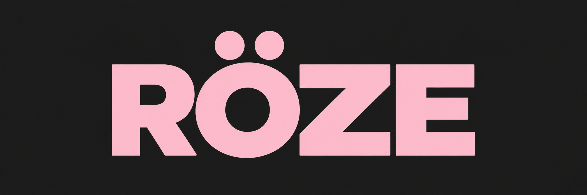

<p align="center"></p>

röze is a sampler VST built with JUCE (VST3 & Standalone).<br/>
röze supports its own sampling engine, built from scratch (`engine/`). <br/>
röze supports 47 audio formats out of the box, with automatic format detection.<br/>
röze supports loading, mapping and playing your sounds straight from your DAW. <br/>
<br/>

röze build <br/>

```bash
cmake -B build -G Ninja && cmake --build build
```

röze tests <br/>

```bash
cmake --build build --target rozeTests && ./build/rozeTests
```
